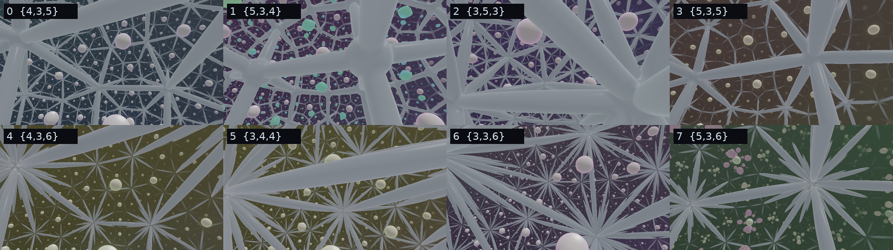
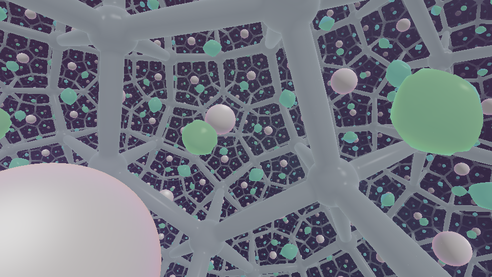

# Not Kansas 2



*The inside of the moon at levels 0 to 7, drawn headless with software rendering. Top row: the four honeycombs with finite cells. Bottom row: the four with corners at infinity, where the struts run together into the wall. The round balls are the pearls.*



*Level 1 after 2 600 steps of growth: silver frame of right-angled dodecahedra, a pearl at the centre of every cell, and the living crystal of level 2 (green) growing on the faces between the cells.*

In [Not Kansas](https://github.com/anttiluode/NotKansas) the inside of the moon was hyperbolic space, tiled by one honeycomb, and there was only one inside. Here every level has its own inside, and the levels are joined.

- **Every level's moon holds a different honeycomb.** Level 0 has Not Kansas's cubes, five round every edge. Level 1 has dodecahedra, four round an edge. Level 2 has icosahedra, three round an edge. Level 3 has dodecahedra, five round an edge. Those four are *all* the regular honeycombs of hyperbolic space with finite cells and finite corners; there are no others (Coxeter).
- **Levels 4 to 7 reach infinity.** Cubes six round an edge, octahedra four, tetrahedra six, dodecahedra six. Their cells have finite volume but their corners lie on the wall, infinitely far away, so the struts never meet: they run together into the wall.
- **Level 8 has the cubes again**, inside a new outside world. The outside worlds never repeat (each level has its own crystal law, as in CrystalMoon V2); the honeycombs go round in eight.
- **The living crystal grows on the walls between the cells.** In Not Kansas it sat at the centre of each cube. Here every face of every cell carries a piece of the next world's crystal, folded in by the honeycomb's mirrors, and the centre is left free.
- **A pearl sits at the centre of every cell.** Fly into any one and you come out in the next level's outside world. That is the world whose crystal you were looking at inside the cells. Its moon holds the next honeycomb.
- **Level 0 and level 1 are duals.** Put a point at the centre of every cube of level 0 and join neighbours: you get level 1's dodecahedra. The pearls of one level sit where the corners of the other are. Levels 2 and 3 are each their own dual.

One HTML page, WebGL2, no libraries. **Live (once Pages is on for this repo):** https://anttiluode.github.io/NotKansas2/ · add `?level=3` to start at level 3.

**Keys:** W A S D fly · R F up/down · Q E roll · Shift fast · mouse look (click to capture) · M face the moon · V camera · fly **into** the moon · **X** leave it · fly into a **pearl** to go down a level · K switches the inside to V2's inversion.

## The mathematics

**One construction for all of them.** The honeycomb {p,q,r} has cells {p,q} (p-sided faces, q round a corner) and r cells round every edge. Its symmetry group is the Coxeter group [p,q,r]: four mirrors m0, m1, m2, m3 with

```
angle(m0,m1) = π/p      angle(m1,m2) = π/q      angle(m2,m3) = π/r      every other pair at right angles
```

In the Poincaré ball, put the centre of one cell at the origin. Then m0, m1, m2 are flat planes through the origin (they are the cell's own symmetry) and m3 is the cell's face, a sphere that meets the wall at right angles:

```
n0 = (1, 0, 0)      n1 = (−cos π/p, sin π/p, 0)      n2 = (0, a, b),   a = −cos(π/q) / sin(π/p),   b = √(1 − a²)

face:   centre (0, 0, c),  radius ρ,       ρ² = b² / (cos²(π/r) − b²),       c² = 1 + ρ²
```

The first line fixes the angles between the planes. The face's centre lies on m0 and m1, so it meets them at right angles; ρ is the one number that makes it meet m2 at π/r; c² = 1 + ρ² is the right angle with the wall. For {4,3,5} this gives ρ² = 1 + √5, Not Kansas's number.

The denominator says which honeycombs exist. If cos²(π/r) > b² the face is a real sphere and the honeycomb lives in hyperbolic space. If they are equal the "sphere" is a flat plane and the honeycomb is Euclidean ({4,3,4}, ordinary cubes: b² = ½ = cos² 45°). If it is smaller there is no ball at all: the honeycomb closes up on a sphere.

| level | honeycomb | cell | round an edge | dihedral angle | inradius | circumradius |
|---|---|---|---|---|---|---|
| 0 | {4,3,5} | cube | 5 | 72° | 0.5306 | 1.2265 |
| 1 | {5,3,4} | dodecahedron | 4 | 90° | 0.8085 | 1.2265 |
| 2 | {3,5,3} | icosahedron | 3 | 120° | 0.8683 | 1.3826 |
| 3 | {5,3,5} | dodecahedron | 5 | 72° | 0.9964 | 1.9028 |
| 4 | {4,3,6} | cube | 6 | 60° | 0.6585 | ∞ |
| 5 | {3,4,4} | octahedron | 4 | 90° | 0.6585 | ∞ |
| 6 | {3,3,6} | tetrahedron | 6 | 60° | 0.3466 | ∞ |
| 7 | {5,3,6} | dodecahedron | 6 | 60° | 1.0839 | ∞ |

(Distances are hyperbolic, in units where the curvature is −1. Level 1's dodecahedra have all right angles.)

**The fold.** To find what is at a point, reflect it in whichever mirror it is on the wrong side of, and repeat until it is on the right side of all four. It is then in the *chamber*, a thin tetrahedron with corners at the cell's centre, a face centre, an edge midpoint and a vertex. The number of face reflections used is how many cell walls lay between the point and the centre. The shader and `core.js` run the same loop.

**The struts** run along the cell's edges. In the chamber the edge is the geodesic where m2 meets the face. If s2 and s3 are the sinh of the distances to those two mirrors, which meet at π/r, then the distance d to the edge is exactly

```
sinh d = √(s2² + s3² + 2 s2 s3 cos π/r) / sin π/r
```

The renderer uses this distance to draw struts of the same hyperbolic thickness everywhere, and also to choose its step, so a ray cannot step over a strut or a pearl. (Not Kansas's far struts were dotted for that reason.)

**The pearls** are balls of hyperbolic radius 0.24 × the inradius at the centre of every cell: in the chamber, the points near the origin. The crystal keeps a clear shell round them. The crystal shown at a point is the next world's field at `island + (fold(x) − face centre) · 40` voxels, so each face has an island of crystal centred on it, with the face's own p-fold symmetry.

**Rays and flight** are Not Kansas's: geodesics are the light rays of a medium with index 2/(1 − r²), and flying forward bends the view along the same arcs.

## Ledger

`node tests/kansas2.test.cjs` (6/6, seconds):

| test | result |
|---|---|
| N1 the four mirrors of each honeycomb obey the relations of [p,q,r]: (m0m1)^p = (m1m2)^q = (m2m3)^r = 1, the other pairs commute, and no smaller power is the identity | 40 points per relation, 8 honeycombs: no point moves more than 8e-14 |
| N2 every face meets the wall at right angles; the dihedral angle, measured where two neighbouring faces cross, is 360°/r; corners are inside the ball at levels 0–3 and on the wall at 4–7 | 72°, 90°, 120°, 72°, 60°, 90°, 60°, 60° to 6 decimals; {4,3,5} gives Not Kansas's inradius 0.5306375310 and circumradius 1.2264568713 |
| N3 duality | inradius of {5,3,4} = half the edge of {4,3,5} = 0.808460834, and the other way round = 0.530637531; both circumradii 1.226456871; {3,5,3} and {5,3,5} have inradius = half edge |
| N4 the fold: 4000 points per honeycomb out to hyperbolic radius 4.86 (where the renderer stops) | finite cells: all land in the chamber within 17 passes. Corners at infinity: {4,3,6} and {5,3,6} all land within 40; {3,4,4} leaves 1 point and {3,3,6} 6 points of 4000 unfinished after 40 passes. Nearby pairs keep their distance to 9e-8 |
| N5 the strut formula against a brute-force search along the edge | largest difference 2.9e-8 |
| N6 eight honeycombs, then round again; the pearl fits in its cell | pearl radii 0.083 to 0.260 |

`node tests/core.test.cjs` is CrystalMoon V2's ledger for the crystal, light, membrane and camera, unchanged.

**Checked in the page** (headless Chromium, software rendering):

- `index.html?selftest`: the GPU simulation equals the CPU one, largest difference 6.7e-8 (the simulation is Not Kansas's, untouched).
- Live run started at `?level=2`: the HUD reads {3,5,3}, icosahedra, 120°. Placed inside the moon, then at the centre of the central cell (inside its pearl): the next frame is level 3 outside, HUD {5,3,5}, no WebGL error.
- All eight honeycombs were drawn from inside (the picture above).

## What this is not

- **It has not run on a real GPU.** Built and checked with software rendering. Inside the moon each ray takes up to 140 steps, and each step folds the point (up to 40 passes of four mirror tests; 17 are enough when the cells are finite). That is more work per pixel than Not Kansas. The frame rate on an RTX 3060 is not measured; *hold the frame rate* lowers the render scale under 40 fps.
- **The crystal still does not grow in hyperbolic space.** It grows in the next world's flat 64³ grid and is folded onto the faces. Every face shows the same island, kaleidoscoped.
- **The frame and the pearls are drawn, not grown.** They are exact distance shapes, shaded.
- **You cannot come back up.** A pearl takes you down one level; X only takes you from inside a moon to the outside of the same level. (The descent was one way in CrystalMoon V2 as well.)
- **Arrival is always at the same place** in the new outside world, facing its moon. The pearl you chose makes no difference: by the honeycomb's symmetry they are all the same pearl.
- **In the four honeycombs with corners at infinity the fold does not always finish** near a corner (N4: up to 6 points in 4000). Those points are in the far haze, where the picture fades to the wall's colour anyway.
- **Far struts thin out and vanish.** Size falls off exponentially with distance in hyperbolic space, so beyond a few cells the struts are thinner than a pixel. They are no longer dotted, but they do disappear. The cutoff at r = 0.985 is Not Kansas's.
- **The moon seen from outside is still grainy**, as in Not Kansas ([shots/level1-outside.png](shots/level1-outside.png)): the view starts at the wall, where every cell is smaller than a pixel.
- **Only eight honeycombs.** Hyperbolic space has fifteen regular ones (four with finite cells, eleven reaching infinity). The other seven have cells or corners that are themselves infinite tilings ({6,3,3}, {4,4,3}, {3,6,3}, {6,3,4}, {4,4,4}, {6,3,5}, {6,3,6}); the fold here needs a cell with a centre, so they are left out.
- **The pictures show almost no crystal** except the level-1 one: software rendering is too slow to grow eight worlds.
- **K (V2's inversion inside the moon) is still there** and still descends the V2 way, without honeycombs. Not Kansas's Kaplansky page is not copied here.

## Files

- `index.html`: the world (Not Kansas's simulation and renderer; `foldH`, `edgeD`, the pearls and `descend` are new)
- `core.js`: the laws and CPU reference. New: `honey(p,q,r)`, `HONEYS`, `honeyOf(level)`, `mirror`, `foldH`, `edgeSinh`
- `tests/kansas2.test.cjs`: N1–N6 · `tests/core.test.cjs`: V2's T1–T12

Built with Claude (Fable 5.2), Tuesday 10 November 2026, from Not Kansas (Claude Opus 5.5 with Antti Luode, 7 November 2026).
